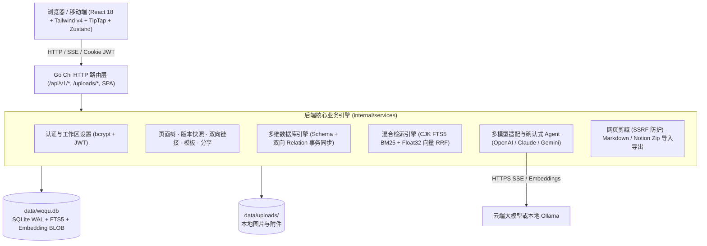

<div align="center">

# ✨ 我趣文档 Woqu

**对标 Notion 与 Wolai 的私有化自托管知识库 · 多维数据库 · AI 写作与 Agent 中枢**

[](https://go.dev/)
[](https://react.dev/)
[](https://sqlite.org/)
[](./Dockerfile)

[🌐 打开同款风格交互式使用文档](./docs/index.html) · [📖 上手与效率指南](./docs/user-guide.md) · [✏️ 块级编辑器手册](./docs/editor-guide.md) · [🗃️ 多维表与公式参考](./docs/database-formula.md) · [🤖 AI 与 Agent 指南](./docs/ai-guide.md) · [🚀 部署与 API 文档](./docs/deployment.md)

</div>

---

> [!NOTE]
> **为什么做 Woqu？**
> 市面上的云端笔记在多端同步方面固然方便，但当你需要**完全掌握个人知识资产、离线/内网私有部署、自由切换 DeepSeek / 通义 / Claude / Gemini / 本地 Ollama 大模型、同时又不愿牺牲 Notion 多维表与 Wolai 精致中文排版**时，一个单目录持久化、零外部数据库依赖的自托管系统是最理想的答案。

---

## ✨ 核心亮点全景

| 模块 | 核心能力 |
| --- | --- |
| **✏️ 块级富文本编辑器** | 基于 TipTap (ProseMirror) 深度定制：24 个 `/` 斜杠命令、`[[` 双向链接自动补全、块级 UUID 锚点与悬浮拖拽手柄；内置 **8 色柔色提示块 (Callout)**、折叠块、2/3 栏分栏、**Mermaid 实时图表**、**KaTeX 数学公式**、网页书签、附件上传及**文档内嵌多维数据库** |
| **🗃️ 完整多维数据库** | **Notion 统一行模型**（每行记录即完整富文本页面，支持侧滑抽屉与全页切换）；支持 **表格 / 看板 / 日历 / 画廊** 4 大视图；覆盖 **18 种字段类型**、**双向 Relation 自动联动**、**14 种 Rollup 汇总**、**52 个函数的 AST 公式引擎**与 **AI 自动填充列** |
| **🤖 多模型 AI 与安全 Agent** | 支持 **OpenAI 兼容**（DeepSeek / 通义千问 / 硅基流动 / Ollama）、**Anthropic Claude**、**Google Gemini** 三协议原生接入；API Key 使用 **AES-256-GCM** 加密落库；提供**划词流式 Diff 预览**、一键页面摘要与待办提取、**FTS5 + 向量 RRF 全库 RAG 问答**，以及 **只读自动执行 + 写操作卡片确认 + `pre_ai` 版本快照** 的安全 Agent |
| **🕸️ 知识库效率工具** | `Cmd/Ctrl + K` 中文分词全文检索、双向链接反向索引、**交互式力导向知识图谱**、历史版本快照与一键回滚、模板中心（5 套内置 + 自定义）、**SSRF 防护网页剪藏**、单页密码/过期时间公开只读分享、Markdown/HTML/PDF 导出、**Notion Export Zip 导入**与 **`VACUUM INTO` 热备份还原** |
| **📦 极致轻量单目录部署** | 后端纯 Go 编译（`CGO_ENABLED=0` + `modernc.org/sqlite` + `go:embed` 内嵌前端），单二进制或单容器即可运行；所有数据集中保存于 `./data/`，备份迁移只需打包一个文件夹 |

---

## 🏗️ 系统架构



---

## 🚀 三种快速启动方式

### 方式一：Docker Compose 一键部署（推荐生产/NAS/VPS）

```bash
git clone git@github.com:backbay2/woqu.git
cd woqu
docker compose up -d --build
```

启动后访问 `http://localhost:8080`，数据持久保存在 `./data/` 目录。

### 方式二：Windows / Linux 编译单二进制直接运行

需要 Go 1.24+、Node.js 20+ 与 pnpm：

```bash
# 1. 构建前端静态资源
cd frontend
pnpm install
pnpm build

# 2. 复制静态产物到 Go embed 目录并编译单二进制
cd ..
rm -rf backend/internal/static/dist/*
cp -r frontend/dist/* backend/internal/static/dist/
cd backend
CGO_ENABLED=0 go build -ldflags="-s -w" -o ../woqu ./cmd/woqu

# 3. 启动服务（Windows 下为 woqu.exe）
cd ..
./woqu
```

### 方式三：Windows 本地前后端热重载开发

```powershell
./scripts/dev.ps1
```

后端监听 `:8080`，Vite 前端开发服务监听 `http://localhost:5173` 并自动代理 `/api` 与 `/uploads`。

---

## 📚 完整使用文档索引

> [!TIP]
> 如果你更喜欢**与 Woqu 应用同款的交互式阅读体验**（支持浅/深主题切换、全站搜索、按分类筛选 52 个公式与 24 个斜杠命令），可以直接在浏览器打开 [`docs/index.html`](./docs/index.html)，或在运行中的 Woqu 界面左下角点击 **「使用文档」**。

| 文档 | 适用场景与核心内容 |
| --- | --- |
| [**🌐 交互式网页使用文档 (`docs/index.html`)**](./docs/index.html) | 同款三栏浅深双主题阅读器，内置实时搜索、公式/斜杠命令速查过滤器与大纲导航 |
| [**📖 上手与效率功能指南 (`docs/user-guide.md`)**](./docs/user-guide.md) | 初始化向导、三栏界面、页面树拖拽、全局混合搜索、图谱、版本回滚、模板、剪藏、公开分享、Notion 导入与备份还原 |
| [**✏️ 块级编辑器完全手册 (`docs/editor-guide.md`)**](./docs/editor-guide.md) | 24 个 `/` 斜杠命令全览、`[[` 双向链接、拖拽手柄与块锚点、Callout/Mermaid/KaTeX/分栏/内嵌数据库、划词 Diff 与快捷键 |
| [**🗃️ 多维数据库与公式引擎参考 (`docs/database-formula.md`)**](./docs/database-formula.md) | 表格/看板/日历/画廊四视图、18 种字段类型、双向 Relation、14 种 Rollup 汇总、52 个公式函数完整语法与实战范例 |
| [**🤖 多模型 AI、RAG 与 Agent 指南 (`docs/ai-guide.md`)**](./docs/ai-guide.md) | 7 家模型预设与本地 Ollama 配置、按任务路由、自定义 Prompt 模板、混合 RAG 原理与确认卡片 Agent 安全机制 |
| [**🚀 部署运维、反代与 API 参考 (`docs/deployment.md`)**](./docs/deployment.md) | Docker / 单二进制部署、环境变量表、Nginx/Caddy SSE 反向代理配置、核心 API 清单与常见问题排查 |

---

## 🛠️ 技术栈

- **后端**：Go 1.24 · `go-chi/chi/v5` · `modernc.org/sqlite`（纯 Go SQLite，免 CGO）· `golang-jwt/jwt/v5` · `golang.org/x/crypto` · `golang.org/x/net`
- **前端**：React 18.3 · TypeScript 5 · Vite 6 · Tailwind CSS v4 · Zustand · React Router v6 · Lucide React
- **编辑器与渲染**：TipTap v2 (`ProseMirror`) · `@dnd-kit` · `lowlight` · `katex` · `mermaid`
