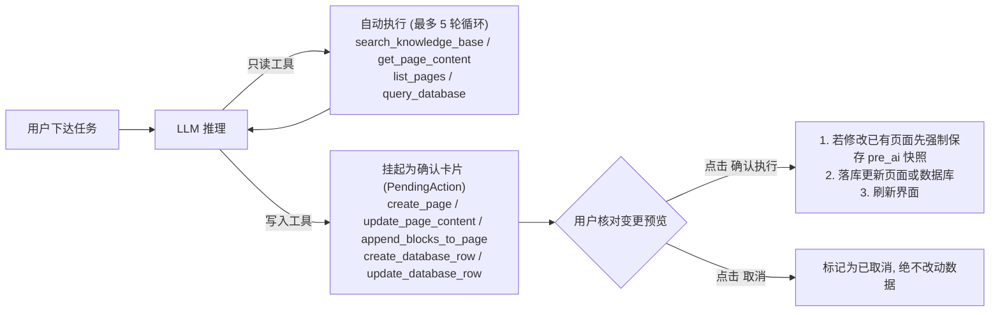

# 🤖 多模型 AI 中心、RAG 混合检索与安全 Agent 指南

Woqu 将 AI 能力深度融入编辑器、多维数据库与知识库问答三大场景，支持自由配置多组云端或本地私有化模型，且**所有写操作均受结构化确认卡片与 `pre_ai` 版本快照双保险保护**。

---

## 目录

- [1. 多模型配置中心与密钥安全](#1-多模型配置中心与密钥安全)
- [2. 按任务智能路由模型](#2-按任务智能路由模型)
- [3. 本地 Ollama 私有化配置指南](#3-本地-ollama-私有化配置指南)
- [4. 文档 AI：划词 Diff、斜杠写作与一键摘要](#4-文档-ai划词-diff斜杠写作与一键摘要)
- [5. 自定义 AI 快捷指令库 (`Prompt Templates`)](#5-自定义-ai-快捷指令库-prompt-templates)
- [6. 全库 RAG 混合检索与带引用问答](#6-全库-rag-混合检索与带引用问答)
- [7. 安全确认式 AI Agent 行动机制](#7-安全确认式-ai-agent-行动机制)

---

## 1. 多模型配置中心与密钥安全

点击左侧栏左下角 **「系统与 AI 设置 → AI 模型中心」**，你可以同时接入多个大模型服务商：

### 支持的三大协议与 7 家快捷预设
| 协议类型 (`provider_type`) | 预设厂商 | 默认 Base URL | 常用模型示例 |
| --- | --- | --- | --- |
| `openai_compatible` | **DeepSeek** | `https://api.deepseek.com/v1` | `deepseek-chat`, `deepseek-reasoner` |
| `openai_compatible` | **OpenAI** | `https://api.openai.com/v1` | `gpt-4o-mini`, `gpt-4o`, `text-embedding-3-small` |
| `openai_compatible` | **通义千问 (DashScope)** | `https://dashscope.aliyuncs.com/compatible-mode/v1` | `qwen-plus`, `qwen-max`, `text-embedding-v3` |
| `openai_compatible` | **硅基流动 SiliconFlow** | `https://api.siliconflow.cn/v1` | `Qwen/Qwen2.5-72B-Instruct`, `BAAI/bge-m3` |
| `openai_compatible` | **本地 Ollama** | `http://localhost:11434/v1` | `qwen2.5:7b`, `nomic-embed-text` |
| `anthropic` | **Anthropic Claude** | `https://api.anthropic.com` | `claude-3-7-sonnet-latest`, `claude-3-5-haiku-latest` |
| `gemini` | **Google Gemini** | `https://generativelanguage.googleapis.com` | `gemini-2.5-flash`, `gemini-2.5-pro`, `text-embedding-004` |

> [!IMPORTANT]
> **API Key 安全保障**：你提交的 API Key 会立即在服务端使用 **AES-256-GCM** 加密后存入 `woqu.db`。前端查询列表时仅返回掩码（例如 `sk-****3456`），永远不会下发明文密钥。加密主密钥会自动持久化至 `data/.secrets.json`（或通过环境变量 `WOQU_MASTER_KEY` 覆盖），重启后所有密钥依然可正常解密。

添加后点击该服务商卡片右侧 **「测试连接」**，服务端会发起一次真实轻量请求并返回耗时（ms）与响应状态。

---

## 2. 按任务智能路由模型

在 AI 模型中心下方的 **「按任务路由模型」** 区域，你可以把不同任务分配给性价比或能力最合适的模型（未单独指定时会自动回退到「默认对话」或首个可用模型）：

| 任务槽位 | 覆盖场景 | 推荐选型思路 |
| --- | --- | --- |
| **RAG 知识库对话 & Agent (`chat`)** | 右侧 AI 侧边栏多轮问答、工具调用 | 推理与 Tool Calling 能力强的模型（如 DeepSeek Chat / GPT-4o / Claude Sonnet / Gemini Pro） |
| **划词润色 / 斜杠 AI 写作 (`writing`)** | 选中文字 Diff 优化、`/` 续写与大纲 | 中文文笔自然、流式响应快的模型 |
| **页面摘要 & 待办提取 (`summary`)** | 页面顶部一键摘要、网页剪藏顺手摘要 | 高性价比轻量高速模型（如 Gemini Flash / DeepSeek / Qwen-Plus） |
| **多维表 AI 自动填充 (`autofill`)** | 数据库 `ai_autofill` 列单行/批量填充 | 轻量精准提取模型 |
| **向量 Embedding 模型 (`embedding`)** | 全库语义向量索引与混合检索（可选） | 如 `text-embedding-3-small`、`BAAI/bge-m3`、`text-embedding-004` 或本地 `nomic-embed-text` |

---

## 3. 本地 Ollama 私有化配置指南

如果你希望 **100% 离线数据不出内网**：

1. 在宿主机安装并启动 Ollama，拉取对话模型与向量模型：
   ```bash
   ollama pull qwen2.5:7b
   ollama pull nomic-embed-text
   ```
2. 在 Woqu 的 **「AI 模型中心」** 点击 **「+ 本地 Ollama」** 预设：
   - **Base URL**：
     - 如果 Woqu 以单二进制直接在宿主机运行：保持默认 `http://localhost:11434/v1`；
     - 如果 Woqu 运行在 Docker 容器内访问宿主机 Ollama：改为 `http://host.docker.internal:11434/v1`（Linux 宿主机需在 `docker-compose.yml` 添加 `extra_hosts: ["host.docker.internal:host-gateway"]` 或开启 Ollama `0.0.0.0:11434`）。
   - **API Key**：留空即可。
   - **模型列表**：填写 `qwen2.5:7b, nomic-embed-text`。
3. 分别把 `chat` / `writing` / `summary` / `autofill` 路由到 `qwen2.5:7b`，把 `embedding` 路由到 `nomic-embed-text`，保存后点击 **「重建全库向量索引」** 即可实现完全本地化的向量 + 全文检索知识库。

---

## 4. 文档 AI：划词 Diff、斜杠写作与一键摘要

1. **划词优化 + 可视化 Diff**：选中正文任意文本，点击浮动栏 **「AI 优化」** 选择内置/自定义指令或输入临时要求；流式生成结束后会显示 **红删绿增的词级 Diff 预览**，一键 **替换选中 / 插入下方 / 重新生成 / 丢弃**。
2. **斜杠写作**：文档中输入 `/` 选择 **「AI 智能续写」** 或 **「AI 生成大纲 / 草稿」**，AI 会结合光标前上下文直接在文档中生成建议内容。
3. **一键页面摘要与待办**：点击文档顶部「AI 文档摘要与待办提炼」卡片的 **「一键生成摘要」**，流式生成包含 **核心摘要 + 关键要点 + 行动项** 的结构化总结；点击 **「插入正文」** 可一键插入为紫色 Callout 块。

---

## 5. 自定义 AI 快捷指令库 (`Prompt Templates`)

在 **「系统与 AI 设置 → AI 快捷指令库」** 中，你可以管理内置与自定义的划词指令：

- **内置 8 项快捷指令**：`✨ 润色文字`、`📝 扩写内容`、`✂️ 精简压缩`、`🔍 纠错与语法修正`、`💼 转为专业正式语气`、`☕ 转为轻松自然语气`、`🌐 翻译为英文`、`🇨🇳 翻译为中文`。
- **自定义指令**：输入指令名称、可选系统人设 (`System Prompt`) 与用户模板（使用 `{{selection}}` 代表用户当前划选的文字，例如：`请将以下会议记录整理为三点结论：\n\n{{selection}}`）。保存后立即出现在编辑器的划词菜单中。

---

## 6. 全库 RAG 混合检索与带引用问答

打开右上角 **「AI 助手」** 侧边栏，顶部支持切换三个检索作用域：
- **当前页 (`current_page`)**：仅针对正在阅读的这篇文档进行深度问答；
- **当前目录 (`folder`)**：限定检索当前页面及其所有子孙页面；
- **全部知识库 (`all`)**：跨全库检索全部未进回收站的页面与数据库行。

### 混合检索原理
1. 每次编辑保存页面时，后端会按 `H1/H2/H3` 标题路径将正文切分为约 600 字的语义分块 (`page_chunks`)，同步写入 `pages_fts` 并（若已配置 Embedding 模型）异步计算 Float32 向量存为 SQLite `BLOB`。
2. 提问时，服务端同时执行 **CJK 中文分词 FTS5 BM25 检索** 与 **内存余弦相似度检索**，通过 **RRF（Reciprocal Rank Fusion）** 算法融合出最相关的 Top-6 片段注入模型上下文。
3. 回答区上方会即时显示可点击的来源引用胶囊（如 `[1] 📄 核心设计文档`），点击直达原文档；**即使完全不配置 Embedding 模型，系统也会自动降级为纯 FTS5 关键词检索，保证开箱可用**。

---

## 7. 安全确认式 AI Agent 行动机制

Woqu 的 AI 侧边栏不仅能“回答问题”，还内置了 **9 个工具调用能力**，并严格区分“只读”与“写入”权限：



- **只读工具自动执行**：大模型需要查阅某篇文档或查询某个多维表数据时会自动检索并在界面提示当前状态（如 `正在检索知识库...`）。
- **写操作必须卡片确认**：当模型提出新建页面、改写现有页面、末尾追加块、新增或更新数据库行时，不会擅自落库，而是弹出琥珀色 **变更确认卡片**，你可以展开「查看变更预览」核对所有参数，再决定点击 **「确认执行」** 或 **「取消」**。
- **`pre_ai` 快照兜底**：对已有页面或记录执行任何 AI 确认写入前，服务端都会先强制在 `page_versions` 表生成一条 `source = 'pre_ai'` 的完整快照，随时可一键回滚。
